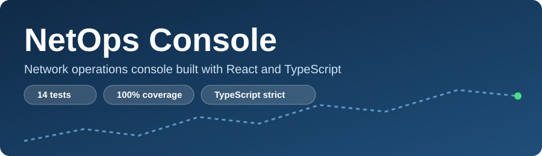
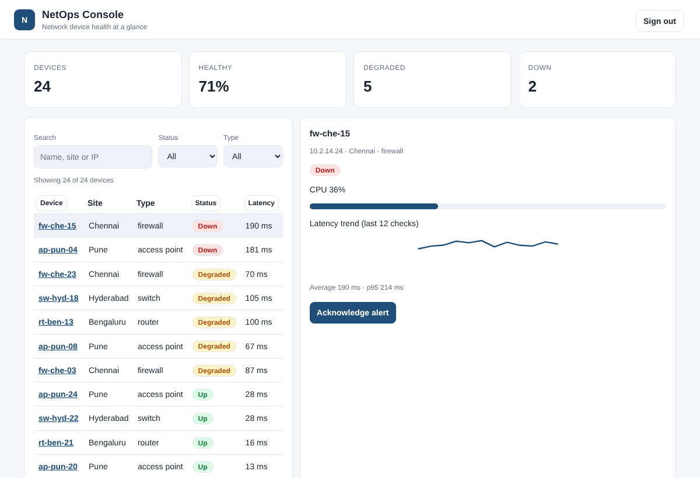

<p align="center"></p>

<p align="center">
  <a href="https://netops-console.netlify.app"></a>
</p>
<p align="center">
  
  
  
  
  
  
</p>

A network operations dashboard. An engineer signs in, sees the health of a fleet of routers, switches, firewalls and access points, finds a problem device quickly, and acknowledges its alert.

<p align="center"></p>

## Try it in 30 seconds
Open the **[live demo](https://netops-console.netlify.app)** and click **Sign in**. The demo account is filled in for you (`engineer` / `demo123`).

1. Read the four summary cards. They show total devices, healthy percentage, degraded and down.
2. Pick **Down** in the Status filter, or type `che` to find devices in Chennai.
3. Click a device name to open its details: CPU, latency trend, average and p95 latency.
4. Click **Acknowledge alert** on a device that is down or degraded.
5. Click a column header to sort. Devices start sorted with the most serious problems first.

## What I focused on
| Area | How it shows in the app |
|---|---|
| **Simple, clear UX** | The worst devices are on top, one summary row, one detail panel. Nothing needs explaining. |
| **Accessibility** | Every input has a label, sortable headers announce their state, the device count updates for screen readers, focus is clearly visible, and status is shown as text and not only color. |
| **Responsive** | Works from phone to desktop. Dark mode follows the system setting. |
| **Secure coding** | No raw HTML is ever injected, so React escapes all text. The site ships with a Content Security Policy and other security headers. The session is kept only for the browser tab. |
| **Testing** | 11 automated tests cover the logic and the real user flows. |
| **Clean structure** | Data, business logic and screens are in separate files, and the logic has no UI code in it. |

## Quality
- **11 tests** (Vitest and React Testing Library) with **100% line coverage**. CI fails if line coverage drops below 85%.
- The tests cover wrong password, sign in, filtering and the empty state, opening details, acknowledging an alert, column sorting, and signing out with a session that survives a reload.
- **TypeScript strict mode** is checked on every build, and GitHub Actions runs the tests and the build on every push.

## Project structure
```
src/
  types.ts        Device and status types
  data.ts         Deterministic demo fleet of 24 devices
  logic.ts        Pure functions: summarize, filter, sort, average, p95
  App.tsx         Sign in, dashboard, table and device details
  *.test.ts(x)    Unit and user flow tests
netlify.toml      Build settings and security headers
```

## Honest notes
- Device data is simulated. No real network is monitored.
- Sign in is a browser only demo, so there is no server and no real account system. My other apps, [PipelineHQ](https://github.com/shaikumar11/PipelineHQ) and [PeopleOps Hub](https://github.com/shaikumar11/peopleops-hub), use real server side sign in with hashed passwords and signed tokens.

## Run locally
```
npm install
npm run dev      # development server
npm test         # tests with coverage
npm run build    # type check and production build
```

## Built by
**Shaik Mohammed Umar** · [LinkedIn](https://linkedin.com/in/mohammed-umarshaik) · [GitHub](https://github.com/shaikumar11) · umarshaikno1@gmail.com
